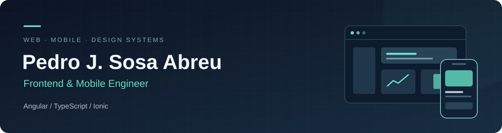

  

  <a href="https://www.linkedin.com/in/pedro-sosa-452196200/">LinkedIn</a> &nbsp; · &nbsp;
  <a href="mailto:pedrososa207@gmail.com">Get in touch / Contacto</a> &nbsp; · &nbsp;
  Santo Domingo, Dominican Republic 🇩🇴

## Hi, I'm Pedro 👋

I'm a **frontend-focused software engineer with 8+ years of frontend experience**, specializing in **Angular, TypeScript, and Ionic**. I build web and cross-platform mobile applications, reusable UI components, and production banking features.

My work combines enterprise engineering, independent product delivery, and technical teaching. I care about maintainable interfaces, consistent user experiences, and clear technical communication.

### What I bring

| Focus | Experience |
| :--- | :--- |
| **Design systems** | Built, integrated, and documented a substantial portion of BHD's Stencil-based Design System, including component bundle optimization that reduced its size by **55%**. |
| **Web & mobile delivery** | Independently developed Tuguru's connected marketplace: two Ionic mobile apps and an Angular administration portal. Published both apps on **Google Play and the App Store**. |
| **Banking applications** | Delivered Angular and Ionic features to production, integrated REST APIs, and improved customer workflows within an established micro-frontend architecture. |
| **Leadership & teaching** | Led **four developers** at Lidax Consulting and taught Angular and Ionic to **400+ students** at ITLA. |

### My toolkit

**Core frontend**

  
  &nbsp;
  
  &nbsp;
  
  &nbsp;
  
  &nbsp;
  
  &nbsp;
  
  &nbsp;
  
  &nbsp;
  

`Angular` `TypeScript` `JavaScript` `React` `React Native` `RxJS` `HTML` `SCSS`

**Mobile & components**

  
  &nbsp;
  
  &nbsp;
  

`Ionic` `Capacitor` `Stencil.js` `Web Components`

**State & testing**

  
  &nbsp;
  
  &nbsp;
  
  &nbsp;
  

`NgRx` `Angular Signals` `Jasmine` `Karma`

**Integration & delivery**

  
  &nbsp;
  
  &nbsp;
  
  &nbsp;
  

`REST APIs` `Firebase` `Node.js` `Git` `Azure DevOps`

My primary specialization is Angular, TypeScript, and Ionic. React and React Native are also part of my toolkit. I have experience modernizing legacy Angular applications.

### Let's connect

I'm interested in **Senior Frontend Engineer** and **Frontend & Mobile Engineer** opportunities in the Dominican Republic and with international remote teams.

---

<strong>🇩🇴 Leer en español</strong>

## Hola, soy Pedro 👋

Soy un **ingeniero de software enfocado en frontend, con más de ocho años de experiencia en esta área**, especializado en **Angular, TypeScript e Ionic**. Desarrollo aplicaciones web y móviles multiplataforma, componentes reutilizables y funcionalidades bancarias en producción.

Mi experiencia combina ingeniería en entornos empresariales, desarrollo independiente de productos y enseñanza técnica. Me interesan las interfaces mantenibles, las experiencias de usuario consistentes y la comunicación técnica clara.

### Lo que aporto

- **Sistemas de diseño:** Construí, integré y documenté una parte sustancial del Design System de BHD basado en Stencil. Su optimización incluyó una reducción del **55% en el tamaño del bundle de componentes**.
- **Desarrollo web y móvil:** Desarrollé de forma independiente el marketplace de Tuguru: dos aplicaciones con Ionic y un portal administrativo con Angular. Publiqué ambas aplicaciones móviles en **Google Play y Apple App Store**.
- **Aplicaciones bancarias:** Implementé funcionalidades con Angular e Ionic en producción, integré APIs REST y mejoré flujos de clientes dentro de una arquitectura de micro-frontends existente.
- **Liderazgo y enseñanza:** Lideré a **cuatro desarrolladores** en Lidax Consulting e impartí formación en Angular e Ionic a **más de 400 estudiantes** en ITLA.

### Tecnologías

- **Frontend:** Angular, TypeScript, JavaScript, React, React Native, RxJS, HTML y SCSS.
- **Móvil y componentes:** Ionic, Capacitor, Stencil.js y Web Components.
- **Estado y pruebas:** NgRx, Angular Signals, Jasmine y Karma.
- **Integración y entrega:** APIs REST, Firebase, Node.js, Git y Azure DevOps.

Mi especialización principal es **Angular, TypeScript e Ionic**. React y React Native también forman parte de mi toolkit. Tengo experiencia modernizando aplicaciones Angular existentes.

Me interesan oportunidades como **Senior Frontend Engineer** y **Frontend & Mobile Engineer**, tanto en República Dominicana como con equipos internacionales en remoto.

